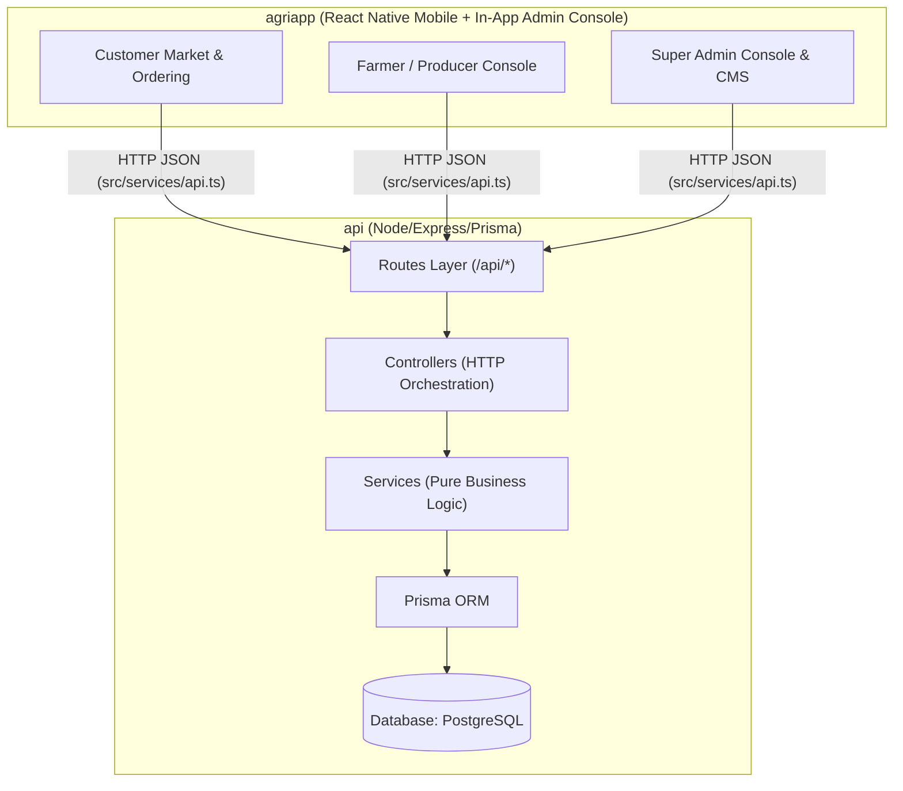

# AgriFlow AI Platform

AI-Powered Organic Product Management & Delivery Platform.

The project is structured into **2 core packages** with a clear and decoupled flow:

```
Organic-app/
├── api/          # Backend REST API (Node.js, Express, TypeScript, Prisma ORM, PostgreSQL)
└── agriapp/      # Unified Mobile Client & Admin Console (React Native, Expo, TypeScript)
```

---

## 🏗️ Architecture & Communication Flow



The mobile client communicates with the backend through a **dedicated centralized API service layer** (`src/services/api.ts`), ensuring zero hardcoding and single-point URL/endpoint configuration.

---

## 📁 3 Core Folders

### 1. `api/` (Backend Microservice-Ready API)
- **Port:** `5050`
- **Tech Stack:** Node.js, Express 4, TypeScript 5, Prisma Client ORM, JWT, bcryptjs.
- **Layers:**
  - `src/config/`: Database singleton (`db.ts`) and environment config (`index.ts`).
  - `src/routes/`: Separately managed domain endpoints (`auth`, `products`, `orders`, `vendor-requests`, etc.).
  - `src/controllers/`: Request/response validation and handler dispatching.
  - `src/services/`: Isolated business logic and database access.
  - `src/middlewares/`: JWT authentication, RBAC authorization, and error interceptors.
- **Run:**
  ```bash
  cd api
  npm run dev      # Start dev server on http://localhost:5050
  npm run build    # Production TypeScript compile
  ```

### 2. `agriapp/` (Unified Mobile Client & Admin Console)
- **Tech Stack:** React Native, Expo, TypeScript.
- **Roles:**
  - **Customer Portal:** Organic product discovery, smart subscriptions, one-time orders, and wallet balance.
  - **Farmer / Vendor Portal:** Crop catalog registration, inventory updates, and delivery dispatch.
  - **Super Admin Console & CMS:** Live KPIs, promotional banners with dark-to-light gradient palettes, product & category CRUD, vendor approvals, orders, customers, and system audit logs.
- **Run:**
  ```bash
  cd agriapp
  npm start        # Start Expo dev server
  ```

---

## ⚡ Root Workspace Scripts

From the root `Organic-app/` directory, you can also run workspace scripts:

```bash
# Start backend API (Port 5050)
npm run api:dev

# Start Mobile App & Admin Console
npm run app:start
```
