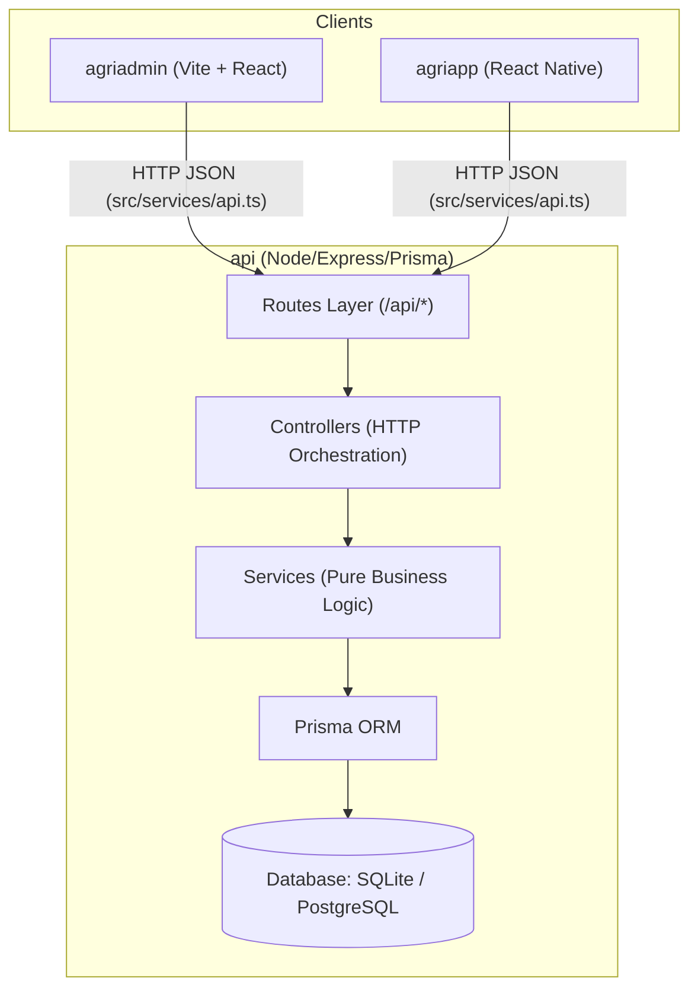

# AgriFlow AI Platform

AI-Powered Organic Product Management & Delivery Platform.

The project is structured into **3 core packages** with a clear and decoupled flow:

```
Organic-app/
├── api/          # Backend REST API (Node.js, Express, TypeScript, Prisma ORM)
├── agriadmin/    # Administrative Web Portal (React 19, TypeScript, Vite)
└── agriapp/      # Multi-Role Mobile Client (React Native, Expo, TypeScript)
```

---

## 🏗️ Architecture & Communication Flow



Both clients communicate with the backend through a **dedicated centralized API service layer** (`src/services/api.ts`), ensuring zero hardcoding and single-point URL/endpoint configuration.

---

## 📁 3 Core Folders

### 1. `api/` (Backend Microservice-Ready API)
- **Port:** `5050`
- **Tech Stack:** Node.js, Express 4, TypeScript 5, Prisma Client ORM, JWT, bcryptjs.
- **Layers:**
  - `src/config/`: Database singleton (`db.ts`) and environment config (`index.ts`).
  - `src/routes/`: Separately managed domain endpoints (`auth`, `products`, `orders`, `vendor-requests`, etc.).
  - `src/controllers/`: Request/response validation and handler dispatching.
  - `src/services/`: Isolated business logic and database access.
  - `src/middlewares/`: JWT authentication, RBAC authorization, and error interceptors.
- **Run:**
  ```bash
  cd api
  npm run dev      # Start dev server on http://localhost:5050
  npm run build    # Production TypeScript compile
  ```

### 2. `agriadmin/` (Administrative Web Portal)
- **Tech Stack:** React 19, TypeScript, Vite 5.
- **Features:** Dashboard KPI metrics, organic product catalog management, category & brand controls, customer records, audit logs, and farmer vendor approvals.
- **Run:**
  ```bash
  cd agriadmin
  npm run dev      # Start web portal on http://localhost:5173
  npm run build    # Production build
  ```

### 3. `agriapp/` (Mobile Application)
- **Tech Stack:** React Native, Expo, TypeScript.
- **Roles:**
  - **Customer Portal:** Organic product discovery, smart subscriptions, one-time orders, and wallet balance.
  - **Vendor Portal:** Crop catalog registration, inventory updates, and delivery dispatch.
  - **Admin Portal:** Live verification and approval of farmer vendor requests.
- **Run:**
  ```bash
  cd agriapp
  npm start        # Start Expo dev server
  ```

---

## ⚡ Root Workspace Scripts

From the root `Organic-app/` directory, you can also run workspace scripts:

```bash
# Start backend API
npm run api:dev

# Build backend API
npm run api:build

# Start Admin web portal
npm run admin:dev

# Build Admin web portal
npm run admin:build
```
