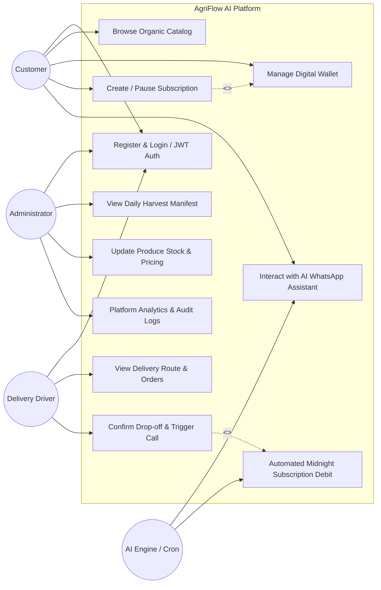
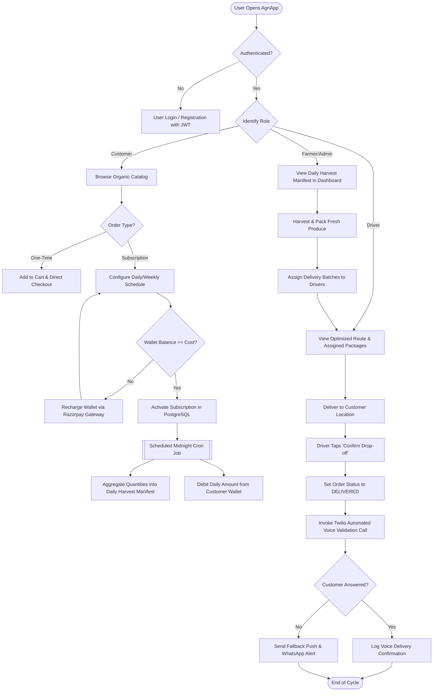
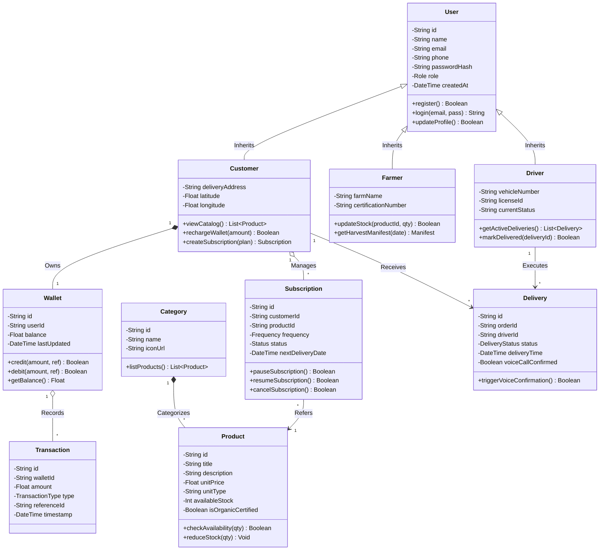
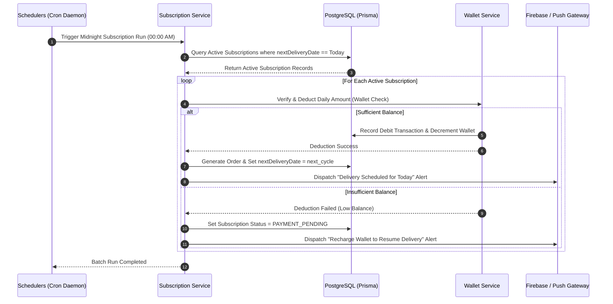
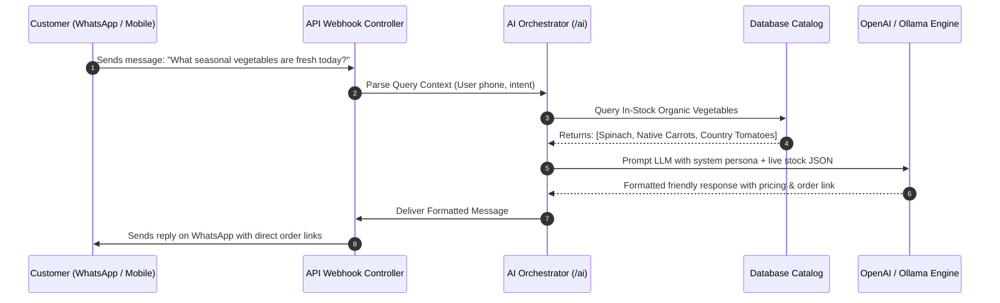
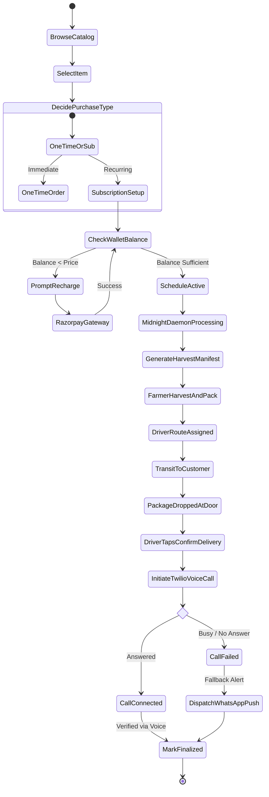
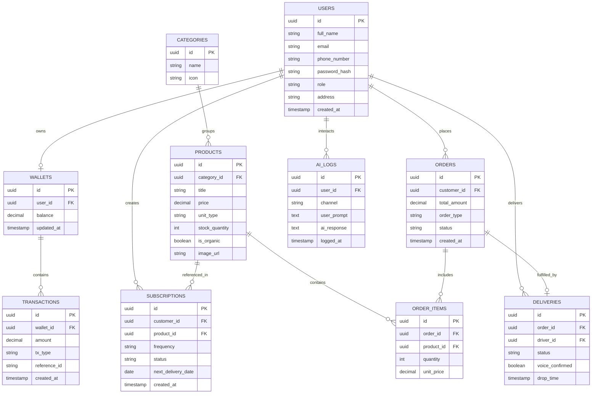

# SYSTEM DESIGN & ARCHITECTURE SPECIFICATION DOCUMENT
## Project Title: AgriFlow AI – AI-Powered Organic Produce Management & Subscription Platform

---

## 1. PROBLEM STATEMENT

### 1.1 Background & Context
The agricultural and organic food supply chain plays an indispensable role in daily consumer health and sustainable farming ecosystems. However, local organic farming commerce in developing and urban fringe markets remains heavily burdened by legacy, fragmented, and manual operational models. Smallholder organic farmers, local distributors, and end-consumers encounter severe friction at each phase of the supply cycle—from harvest forecasting and catalog management to daily subscription logistics, advance billing, and delivery validation.

### 1.2 Core Issues in Existing Systems
1. **Fragmented Communication Channels:**
   - Farmers, delivery partners, and consumers currently coordinate through unstructured telephone calls, personal messaging apps, and handwritten paper ledgers. This lack of centralized tracking leads to lost orders, inaccurate delivery windows, and miscommunication regarding out-of-stock seasonal items.
2. **Cumbersome Subscription Logistics:**
   - Organic goods such as dairy (fresh milk), farm eggs, and seasonal vegetable boxes demand recurring, periodic delivery schedules (e.g., daily, alternate days, weekly). Conventional e-commerce platforms are optimized for one-off retail purchases rather than recurring dynamic subscriptions. Manual management of pause, skip, and resume requests leads to high error rates and billing discrepancies.
3. **Absence of Delivery Traceability and Physical Validation:**
   - Deliveries often happen early in the morning without physical customer handoffs. Without real-time driver tracking, automated drop-off verification, and reliable multi-channel confirmation (such as automated voice calls or push notifications), disputes regarding missing or damaged packages remain untraceable.
4. **Disproportionate Administrative and Customer Support Overhead:**
   - Store owners spend hours manually auditing bank statements to verify UPI/wallet transfers, answering routine queries regarding product availability, and calculating daily harvest quantities. This administrative strain limits scalability.

### 1.3 The Proposed AgriFlow AI Solution
**AgriFlow AI** delivers a unified, cloud-connected, and AI-augmented software ecosystem that bridges organic farms and urban consumers. By integrating a modular 3-tier architecture, an autonomous cron-based subscription engine, real-time digital wallet billing, localized AI conversational interfaces (via WhatsApp and in-app prompt engines), and automated Twilio voice delivery confirmations, AgriFlow AI transforms a high-friction supply chain into an automated, transparent, and scalable digital workflow.

---

## 2. PROJECT OBJECTIVES

### 2.1 Primary Objectives
1. **Provide a Unified Multi-Role Digital Ecosystem:**
   - Deploy dedicated, intuitive interfaces for all three key ecosystem actors: **Customers** (mobile storefront & subscription hub), **Vendors/Farmers** (inventory catalog & harvest manager), and **Administrators** (financial analytics & operations command center).
2. **Automate the Recurring Subscription Lifecycle:**
   - Facilitate flexible subscription options (Daily, Alternate Days, Weekly, Custom) with automated wallet balance checks, scheduled invoice generation, and dynamic pause/resume controls.
3. **Integrate Autonomous AI-Powered Customer Assistance:**
   - Utilize Large Language Model (LLM) agents (OpenAI API / Local Ollama) across mobile interfaces and WhatsApp to automatically resolve product queries, recommend seasonal crops, and modify active subscriptions with zero manual human intervention.
4. **Guarantee Delivery Authenticity and Traceability:**
   - Implement route-optimized drop-off logs for drivers coupled with multi-tier validation mechanisms, including geo-stamped drop logs, automated outbound Twilio voice confirmation calls, and real-time push alerts.

### 2.2 Specific Technical Objectives
- **Sub-200ms API Response Time:** Implement an optimized Node.js/TypeScript REST API backed by PostgreSQL and Prisma ORM with indexing on frequent query paths (orders, active subscriptions).
- **Automated Midnight Job Scheduling:** Use `node-cron` daemons to process daily recurring deductions, generate next-day harvest manifests for farmers, and alert customers of low wallet balances before delivery hours.
- **Fail-Safe Multi-Channel Communications:** Integrate automated fallbacks: if an automated voice verification call fails or is unattended, the system triggers an instant Firebase Cloud Messaging (FCM) push notification and WhatsApp confirmation.

---

## 3. SYSTEM ARCHITECTURE

### 3.1 Architectural Style
AgriFlow AI follows a **Layered 3-Tier Enterprise Architecture** coupled with **Service-Oriented Micro-package Integration**. This decouples the Presentation Layer from Business Logic and Data Persistence, guaranteeing security, modular maintenance, and independent scalability.

```
+=============================================================================+
|                          1. PRESENTATION LAYER                              |
|  +--------------------------------+   +----------------------------------+  |
|  | AgriApp Mobile Client          |   | AgriAdmin Web Dashboard          |  |
|  | (React Native / Expo / Redux)  |   | (React 19 / Vite / Tailwind/CSS) |  |
|  | [Customer & Driver Portals]   |   | [Inventory, Users & Analytics]   |  |
+=============================================================================+
                                       |
                   HTTPS / REST API / JSON Web Tokens (JWT)
                                       v
+=============================================================================+
|                        2. BUSINESS LOGIC LAYER                              |
|  +-----------------------------------------------------------------------+  |
|  | Node.js / Express / TypeScript Backend Server (/api)                  |  |
|  | - Auth & RBAC Middleware (Bcrypt, JWT)                                |  |
|  | - Order & Subscription State Machine                                  |  |
|  | - Digital Wallet & Ledger Controller                                  |  |
|  | - Harvest Aggregator & Delivery Allocator                             |  |
|  +-----------------------------------------------------------------------+  |
|  | Scheduled Daemons (Cron Engines)                                      |  |
|  | - Midnight Wallet Auto-Debit Daemon                                   |  |
|  | - Daily Morning Harvest Manifest Compiler                             |  |
|  | - Low Balance Alert Dispatcher                                        |  |
+=============================================================================+
            |                                           |
    Database Queries (Prisma ORM)             Third-Party API Connectors
            v                                           v
+=============================+    +==========================================+
|    3. DATA PERSISTENCE      |    |        4. EXTERNAL CLOUD SERVICES        |
|  +-----------------------+  |    |  +------------------------------------+  |
|  | PostgreSQL Database   |  |    |  | AI Prompt Engine (OpenAI / Ollama) |  |
|  | - Users & Auth        |  |    |  | Twilio Voice API (Call Validation) |  |
|  | - Catalogs & Harvest  |  |    |  | Razorpay Gateway (Secure Payments) |  |
|  | - Subscriptions       |  |    |  | Firebase Cloud Messaging (Push)   |  |
|  | - Wallets & Ledgers   |  |    |  | WhatsApp Cloud API (Chatbot)       |  |
|  +-----------------------+  |    |  +------------------------------------+  |
+=============================+    +==========================================+
```

### 3.2 Layer Descriptions

1. **Presentation Layer (Client Tier):**
   - **AgriApp (Mobile Client):** Cross-platform mobile application built using React Native and Expo. Operates as the touchpoint for Customers (catalog browsing, cart, wallet top-up, subscription builder) and Delivery Drivers (order drop confirmation, route view).
   - **AgriAdmin (Web Dashboard):** Single Page Application (SPA) built using React and Vite. Enables administrators to monitor revenue charts, adjust catalog pricing, manage role privileges, and inspect system audit logs.
2. **Business Logic Layer (Application Tier):**
   - Built on Node.js and TypeScript utilizing Express.js. Encapsulates business rules such as order state transitions, wallet deduction logic, discount rules, and schedule processing.
   - Includes background workers (`node-cron`) that autonomously process batch tasks outside HTTP request cycles.
3. **Data Persistence Layer (Database Tier):**
   - Relational PostgreSQL database managed via Prisma ORM. Ensures strict ACID transaction compliance, referential integrity via foreign key constraints, and migration tracking.
4. **External Services Tier:**
   - **Payment Gateway:** Razorpay API for handling digital payments, UPI intents, and card processing.
   - **AI Engine:** Dedicated connectors to OpenAI GPT-4o / local Ollama instances for natural language order assistance.
   - **Voice & SMS Gateway:** Twilio Voice API for automated delivery drop-off confirmation calls.
   - **Push Notification Gateway:** Firebase Cloud Messaging (FCM) for low-latency background notifications.

---

## 4. USE CASE DIAGRAM & SPECIFICATIONS

### 4.1 System Actors
1. **Customer:** Registers account, browses organic products, subscribes to daily/weekly schedules, manages digital wallet, chats with AI bot, and tracks deliveries.
2. **Farmer / Vendor:** Manages product catalog, updates stock and pricing, and reviews aggregate daily harvest manifests.
3. **Delivery Driver:** Views assigned delivery routes, marks order drops as completed, and triggers delivery verification calls.
4. **System Administrator:** Oversees platform users, approves vendors, views revenue analytics, inspects system logs, and manages system configurations.
5. **AI Assistant & Schedulers (System Actors):** Processes conversational inputs, answers queries, executes midnight wallet debits, and coordinates third-party APIs.

### 4.2 Use Case Diagram (Textual / Mermaid Representation)



### 4.3 Detailed Use Case Specifications

#### Use Case UC-01: Create Recurring Subscription
| Field | Specification Details |
| :--- | :--- |
| **Use Case ID & Name** | UC-01: Create Recurring Product Subscription |
| **Primary Actor** | Customer |
| **Preconditions** | Customer is logged in; wallet balance is greater than the single delivery amount. |
| **Trigger** | Customer selects "Subscribe" on a recurring product (e.g., Farm Fresh Milk). |
| **Main Success Scenario** | 1. Customer chooses frequency (Daily / Alternate / Weekly) and start date.<br>2. System validates product availability and calculates daily cycle price.<br>3. System checks wallet balance.<br>4. Customer confirms subscription.<br>5. System creates active subscription record and schedules next delivery date.<br>6. Confirmation SMS/Push notification sent. |
| **Alternative Flow** | If wallet balance is insufficient: System prompts customer to recharge wallet via Razorpay before confirming subscription. |
| **Postconditions** | Active subscription created; scheduler includes item in upcoming midnight processing runs. |

#### Use Case UC-02: Delivery Completion & Automated Voice Validation
| Field | Specification Details |
| :--- | :--- |
| **Use Case ID & Name** | UC-02: Mark Order Delivered & Voice Confirmation |
| **Primary Actor** | Delivery Driver & Twilio Cloud Service |
| **Preconditions** | Order status is 'OUT_FOR_DELIVERY'; Driver has arrived at customer drop location. |
| **Trigger** | Driver presses "Confirm Drop-off" on AgriApp mobile driver screen. |
| **Main Success Scenario** | 1. Driver uploads drop-off note/photo and hits confirm.<br>2. System updates order status to 'DELIVERED' with timestamp.<br>3. System invokes Twilio Voice API with customer phone number.<br>4. Twilio places automated confirmation call: *"Your AgriFlow delivery has been placed at your door."*<br>5. Call result logged in system audit trail. |
| **Alternative Flow** | If customer phone is unreachable/busy: System falls back to Firebase Push Notification and WhatsApp delivery confirmation message. |
| **Postconditions** | Order marked finalized; customer notified; driver route updated. |

---

## 5. SYSTEM FLOWCHART

The end-to-end operational flowchart illustrates the complete lifecycle from customer onboarding to daily harvest compilation, automated payment deduction, and delivery confirmation.



---

## 6. UML DIAGRAMS

### 6.1 Class Diagram
The Class Diagram models the object-oriented structure of AgriFlow AI, showing key classes, attributes, access modifiers (`+` public, `-` private, `#` protected), methods, and structural relationships.



---

### 6.2 Sequence Diagrams

#### Sequence Diagram 1: Automated Subscription Processing & Auto-Debit
This sequence illustrates how background cron workers interact with the database, wallet engine, and external notification adapters.



#### Sequence Diagram 2: AI WhatsApp Assistant Query Resolution
This sequence captures how customer natural language queries are parsed, processed through AI models, and answered with live catalog data.



---

### 6.3 Activity Diagram: Order & Subscription Fulfillment Workflow
The Activity Diagram models the step-by-step branching logic from initial customer action to drop verification.



---

## 7. DATABASE DESIGN & DATA DICTIONARY

### 7.1 Entity-Relationship (ER) Model Overview
The AgriFlow AI database is designed around core relational entities:
- **`users`**: Base credentials, multi-role classifications (`CUSTOMER`, `FARMER`, `DRIVER`, `ADMIN`), and contact details.
- **`wallets` & `transactions`**: Pre-paid customer ledger facilitating automated midnight micro-debits without gateway timeouts.
- **`categories` & `products`**: Organic catalog items, certified vendor links, and inventory thresholds.
- **`subscriptions`**: Recurring configuration parameters (frequency, next delivery date, status).
- **`orders` & `order_items`**: Realized delivery records derived either from direct checkouts or subscription executions.
- **`deliveries`**: Driver assignments, geo-stamps, and Twilio voice status.
- **`ai_logs`**: Prompts, intents, and token logs for conversational audits.

### 7.2 Entity Relationship Diagram (ERD)



---

### 7.3 Data Dictionary (Table Schemas)

#### Table 1: `users`
| Column Name | Data Type | Constraints | Description |
| :--- | :--- | :--- | :--- |
| `id` | UUID | PRIMARY KEY, Default `gen_random_uuid()` | Unique identifier for each user |
| `full_name` | VARCHAR(100) | NOT NULL | User's legal name |
| `email` | VARCHAR(120) | UNIQUE, NOT NULL | Login email address |
| `phone_number` | VARCHAR(20) | UNIQUE, NOT NULL | Mobile number (used for WhatsApp & Twilio calls) |
| `password_hash` | VARCHAR(255) | NOT NULL | Bcrypt hashed password |
| `role` | VARCHAR(20) | NOT NULL, DEFAULT 'CUSTOMER' | Enum: `CUSTOMER`, `FARMER`, `DRIVER`, `ADMIN` |
| `address` | TEXT | NULLABLE | Default shipping/delivery address |
| `created_at` | TIMESTAMP | DEFAULT CURRENT_TIMESTAMP | Account creation timestamp |

#### Table 2: `wallets`
| Column Name | Data Type | Constraints | Description |
| :--- | :--- | :--- | :--- |
| `id` | UUID | PRIMARY KEY | Unique identifier for wallet instance |
| `user_id` | UUID | FOREIGN KEY -> `users(id)`, UNIQUE | Linked customer account |
| `balance` | DECIMAL(10,2) | NOT NULL, DEFAULT 0.00 | Available spendable balance |
| `updated_at` | TIMESTAMP | DEFAULT CURRENT_TIMESTAMP | Last credit/debit transaction timestamp |

#### Table 3: `transactions`
| Column Name | Data Type | Constraints | Description |
| :--- | :--- | :--- | :--- |
| `id` | UUID | PRIMARY KEY | Unique transaction record ID |
| `wallet_id` | UUID | FOREIGN KEY -> `wallets(id)` | Target wallet |
| `amount` | DECIMAL(10,2) | NOT NULL | Transaction value |
| `tx_type` | VARCHAR(20) | NOT NULL | Enum: `CREDIT_RECHARGE`, `DEBIT_SUBSCRIPTION`, `REFUND` |
| `reference_id` | VARCHAR(100) | NULLABLE | Razorpay payment ID or internal order ID |
| `created_at` | TIMESTAMP | DEFAULT CURRENT_TIMESTAMP | Timestamp of execution |

#### Table 4: `categories`
| Column Name | Data Type | Constraints | Description |
| :--- | :--- | :--- | :--- |
| `id` | UUID | PRIMARY KEY | Unique category ID |
| `name` | VARCHAR(50) | NOT NULL, UNIQUE | Category name (e.g., Dairy, Greens, Pulses) |
| `icon` | VARCHAR(255) | NULLABLE | Icon identifier or CDN image URL |

#### Table 5: `products`
| Column Name | Data Type | Constraints | Description |
| :--- | :--- | :--- | :--- |
| `id` | UUID | PRIMARY KEY | Unique product ID |
| `category_id` | UUID | FOREIGN KEY -> `categories(id)` | Associated category |
| `title` | VARCHAR(120) | NOT NULL | Product name (e.g., A2 Organic Cow Milk) |
| `price` | DECIMAL(10,2) | NOT NULL | Retail unit price |
| `unit_type` | VARCHAR(20) | NOT NULL | Measurement unit (e.g., 500ml, 1kg, Bundle) |
| `stock_quantity` | INTEGER | NOT NULL, DEFAULT 0 | Current inventory quantity in stock |
| `is_organic` | BOOLEAN | DEFAULT TRUE | Certified organic tag flag |
| `image_url` | VARCHAR(255) | NULLABLE | Product catalog display picture |

#### Table 6: `subscriptions`
| Column Name | Data Type | Constraints | Description |
| :--- | :--- | :--- | :--- |
| `id` | UUID | PRIMARY KEY | Unique subscription schedule ID |
| `customer_id` | UUID | FOREIGN KEY -> `users(id)` | Subscribing customer |
| `product_id` | UUID | FOREIGN KEY -> `products(id)` | Subscribed product |
| `frequency` | VARCHAR(20) | NOT NULL | Enum: `DAILY`, `ALTERNATE_DAYS`, `WEEKLY` |
| `status` | VARCHAR(20) | NOT NULL, DEFAULT 'ACTIVE' | Enum: `ACTIVE`, `PAUSED`, `PAYMENT_PENDING`, `CANCELLED` |
| `next_delivery_date` | DATE | NOT NULL | Date when next delivery drop is scheduled |
| `created_at` | TIMESTAMP | DEFAULT CURRENT_TIMESTAMP | Start date of subscription |

#### Table 7: `orders`
| Column Name | Data Type | Constraints | Description |
| :--- | :--- | :--- | :--- |
| `id` | UUID | PRIMARY KEY | Unique order tracking ID |
| `customer_id` | UUID | FOREIGN KEY -> `users(id)` | Ordering customer |
| `total_amount` | DECIMAL(10,2) | NOT NULL | Total payable order invoice amount |
| `order_type` | VARCHAR(20) | NOT NULL | Enum: `DIRECT_PURCHASE`, `SUBSCRIPTION_DROP` |
| `status` | VARCHAR(30) | NOT NULL, DEFAULT 'PLACED' | Enum: `PLACED`, `PACKED`, `OUT_FOR_DELIVERY`, `DELIVERED`, `CANCELLED` |
| `created_at` | TIMESTAMP | DEFAULT CURRENT_TIMESTAMP | Order creation timestamp |

#### Table 8: `deliveries`
| Column Name | Data Type | Constraints | Description |
| :--- | :--- | :--- | :--- |
| `id` | UUID | PRIMARY KEY | Unique delivery fulfillment record |
| `order_id` | UUID | FOREIGN KEY -> `orders(id)`, UNIQUE | Linked customer order |
| `driver_id` | UUID | FOREIGN KEY -> `users(id)` | Assigned delivery partner |
| `status` | VARCHAR(30) | NOT NULL, DEFAULT 'ASSIGNED' | Enum: `ASSIGNED`, `IN_TRANSIT`, `COMPLETED` |
| `voice_confirmed` | BOOLEAN | DEFAULT FALSE | Whether Twilio call confirmation was acknowledged |
| `drop_time` | TIMESTAMP | NULLABLE | Exact delivery drop timestamp |

---

## 8. UI / WIREFRAME SCREEN SPECIFICATIONS

### 8.1 Screen Hierarchy & Navigation Map

```
[ Splash & Onboarding Screen ]
             |
             v
[ Universal Login / Registration Screen ]
             |
   +---------+-------------------+-----------------------+
   |                             |                       |
[ Customer Portal ]      [ Farmer / Vendor Portal ]  [ Driver Portal ]
   |-- Home / Catalog            |-- Stock Inventory     |-- Active Routes
   |-- Product Detail            |-- Harvest Manifest    |-- Package Drop
   |-- Subscription Scheduler    |-- Price Adjustments   |-- Call Confirm
   |-- Digital Wallet & Top-up   |-- Orders Overview
   |-- AI WhatsApp & Voice Chat
   |-- Order & Delivery History
```

---

### 8.2 Wireframe Layout Specifications

#### Screen 1: Splash & Role-Based Authentication (`UniversalAuth.tsx`)
```
+-------------------------------------------------------------+
|                     AGRIFLOW AI                             |
|          "Pure Organic Produce, Delivered by AI"            |
|                                                             |
|   +-----------------------------------------------------+   |
|   | Select Role: [ (•) Customer  ( ) Farmer  ( ) Driver ]|  |
|   +-----------------------------------------------------+   |
|                                                             |
|   Email Address:                                            |
|   [ user@agriflow.com                                    ]  |
|                                                             |
|   Password:                                                 |
|   [ •••••••••••••••••                                    ]  |
|                                                             |
|   +-----------------------------------------------------+   |
|   |                [ SECURE LOGIN ]                     |   |
|   +-----------------------------------------------------+   |
|                                                             |
|   New to AgriFlow? [ Create an Account ]                    |
|   Instant Login with WhatsApp OTP [ Continue with OTP ]     |
+-------------------------------------------------------------+
```
- **Key Components:** Role switch tabs, email & password validation fields, JWT session initializer, and OTP quick login link.

---

#### Screen 2: Customer Marketplace & Catalog (`CustomerScreens.tsx`)
```
+-------------------------------------------------------------+
| AgriFlow AI 🌿                 [ Wallet: ₹850 ]  [ Bell (2) ]|
+-------------------------------------------------------------+
| Search "fresh cow milk, native spinach, honey..." [🔍]      |
+-------------------------------------------------------------+
| CATEGORIES:                                                 |
| (🥛 Dairy)   (🥬 Greens)   (🥕 Root Veg)   (🍯 Raw Honey)   |
+-------------------------------------------------------------+
| FEATURED ORGANIC CROPS:                                     |
| +-------------------------+     +-------------------------+ |
| | [ IMG: Fresh A2 Milk ]  |     | [ IMG: Farm Eggs (6) ]  | |
| | Fresh A2 Gir Cow Milk   |     | Country Free-Range Eggs | |
| | ₹42 / 500ml  (Organic)  |     | ₹65 / Pack              | |
| | [Buy Once] [Subscribe]  |     | [Buy Once] [Subscribe]  | |
| +-------------------------+     +-------------------------+ |
+-------------------------------------------------------------+
| UPCOMING TOMORROW MORNING:                                  |
| - 1x A2 Cow Milk (500ml) [Active Subscription - In Wallet]  |
+-------------------------------------------------------------+
| [Home]       [Subscriptions]       [AI Assistant]    [Profile]|
+-------------------------------------------------------------+
```
- **Key Components:** Live wallet header badge, category carousel, direct purchase button, recurring subscription modal launcher, and bottom navigation bar.

---

#### Screen 3: Subscription Customizer & Scheduler Modal
```
+-------------------------------------------------------------+
| 🗓️ Set Up Subscription: Fresh A2 Gir Cow Milk (500ml)       |
+-------------------------------------------------------------+
| Select Frequency:                                           |
| [ [X] Daily ]     [ [ ] Alternate Days ]    [ [ ] Weekly ]  |
|                                                             |
| Quantity Per Delivery:                                      |
| [ - ]  1 Packet (500ml)  [ + ]                             |
|                                                             |
| Preferred Delivery Window:                                  |
| (•) Early Morning (05:30 AM - 07:00 AM)                     |
| ( ) Evening Fresh (05:00 PM - 06:30 PM)                     |
|                                                             |
| Start Date: [ Tomorrow, Oct 12 ]                            |
| Monthly Estimated Cost: ₹1,260 (Deducted daily from Wallet) |
| Current Wallet Balance: ₹850 [ Top-up Required in 18 days ] |
|                                                             |
| +---------------------------------------------------------+ |
| |            [ ACTIVATE SUBSCRIPTION NOW ]                | |
| +---------------------------------------------------------+ |
+-------------------------------------------------------------+
```
- **Key Components:** Frequency radio selectors, quantity counter, daily deduction calculation preview, and instant activation trigger.

---

#### Screen 4: AI Assistant & WhatsApp Voice Interface (`AIScreens.tsx`)
```
+-------------------------------------------------------------+
| AgriFlow AI Companion 🤖                     [ WhatsApp Sync]|
+-------------------------------------------------------------+
| [AI]: Hello Priya! Your morning milk was delivered at 6:15  |
|       AM. Do you need extra organic greens for Sunday?      |
|                                                             |
| [You]: Yes, add 1 bunch of organic spinach for tomorrow.    |
|                                                             |
| [AI]: Verified! Added Palak Spinach (₹30) to your delivery. |
|       Your wallet will be debited ₹72 tomorrow morning.     |
+-------------------------------------------------------------+
| Suggestions:                                                |
| [ Pause Milk for 2 Days ]  [ Check Balance ]  [ Crop Season]|
+-------------------------------------------------------------+
| [ Ask anything about produce, orders, or plans...    ] [🎙️] |
|                                             [ SEND ]        |
+-------------------------------------------------------------+
```
- **Key Components:** Real-time conversational bubble thread, natural language intent parser, speech-to-text mic button, and quick-action chips.

---

#### Screen 5: Driver Drop-off & Twilio Voice Confirmation (`VendorScreens.tsx`)
```
+-------------------------------------------------------------+
| 🚚 Driver Route: Zone 4 (Chennai South)        [5/12 Drops]  |
+-------------------------------------------------------------+
| CURRENT STOP: #06                                           |
| Customer: Anand Subramanian                                 |
| Address: Flat 4B, Green Meadows, Velachery, Chennai         |
| Items:                                                      |
| - 2x A2 Milk (500ml)                                        |
| - 1x Country Eggs (Pack of 6)                               |
|                                                             |
| Drop Instructions: "Place inside doorstep milk basket"      |
|                                                             |
| Drop-off Actions:                                           |
| [ 📷 Take Drop Photo ]                                      |
|                                                             |
| +---------------------------------------------------------+ |
| |    [ ✔️ CONFIRM DROP & TRIGGER VOICE VALIDATION ]       | |
| +---------------------------------------------------------+ |
| * This will automatically dial the customer via Twilio      |
|   to confirm early morning contactless package drop-off.    |
+-------------------------------------------------------------+
```
- **Key Components:** Geocoded stop details, customer drop-off instructions, photo proof capture, and one-tap Twilio voice confirmation trigger.

---

#### Screen 6: Admin Analytics Command Center (`agriadmin/Dashboard.tsx`)
```
+-----------------------------------------------------------------------------+
| AGRIFLOW COMMAND CENTER  |  Products  |  Orders  |  Subscribers  |  Logs    |
+-----------------------------------------------------------------------------+
| [ Active Subscribers: 1,420 ]  [ Today's Deliveries: 980 ]  [ Revenue: ₹48k]|
+-----------------------------------------------------------------------------+
| REAL-TIME HARVEST MANIFEST (TOMORROW):                                      |
| - A2 Cow Milk: 640 Liters (85 Farms Allocated)                              |
| - Native Country Eggs: 320 Packs                                            |
| - Palak & Keerai Greens: 210 Bunches                                        |
+-----------------------------------------------------------------------------+
| SYSTEM HEALTH:                                                              |
| - Database (PostgreSQL): ONLINE (4ms query latency)                         |
| - Midnight Auto-Debit Daemon: SUCCESS (100% processed at 00:00:12)          |
| - Twilio Voice API: CONNECTED (97.4% delivery call acknowledgment)          |
| - AI Assistant (Ollama/OpenAI): OPERATIONAL (Avg Response: 1.1s)            |
+-----------------------------------------------------------------------------+
```
- **Key Components:** Key performance indicator (KPI) metric cards, harvest aggregation summary table, system health diagnostics, and audit log links.

---

## 9. CONCLUSION & SUMMARY FOR PROJECT REPORT

The **AgriFlow AI** system design bridges the gap between conventional agriculture and modern automated logistics. Through a decoupled 3-tier architecture, an autonomous cron-driven subscription pipeline, robust PostgreSQL schema design, and AI-assisted conversational ordering, the platform eliminates manual intervention, guarantees transparency, and empowers local organic producers and consumers with a reliable, production-ready solution.
